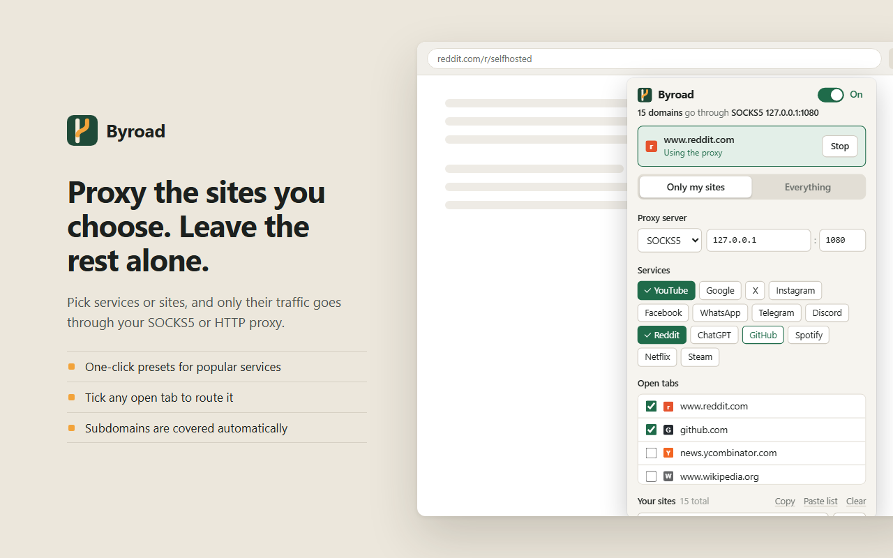

<p align="center">
  
</p>

<h1 align="center">Byroad</h1>

<p align="center">
  A Chrome extension that sends only the sites you pick through your proxy.<br>
  Everything else keeps using your normal connection.
</p>

<p align="center">
  <a href="https://github.com/MeysamRezazadeh/byroad/actions/workflows/ci.yml"></a>
  <a href="https://github.com/MeysamRezazadeh/byroad/releases/latest"></a>
  <a href="LICENSE"></a>
</p>

---

Works with SOCKS5, SOCKS4, HTTP and HTTPS proxies, such as a local v2ray/Xray client, Shadowsocks, Clash, or an SSH tunnel (`ssh -D`). Byroad doesn't provide a proxy; it uses the one you already have.



## Features

- **Two modes.** *Only my sites* routes only the domains on your list. *Everything* routes all traffic, except the sites you list under *Always go direct*.
- **Current site in one click.** The popup shows the tab you're on, with a button to add it or take it off.
- **Services.** Ready-made domain sets for YouTube, Google, X, Instagram, Telegram, Discord, ChatGPT, GitHub, Netflix and more, including the CDN domains each one needs.
- **Open tabs.** Tick any open tab to route it.
- **Subdomains included.** Adding `example.com` also covers `www.example.com`, `cdn.example.com`, and so on.
- **Right-click menu.** *Use proxy for this site* / *Stop using proxy for this site*.
- **Clear warnings** when the proxy can't be reached, or when another extension has taken over Chrome's proxy settings.
- **Copy / paste** your site list between browsers.
- Light and dark themes that follow your system.

## Install

**From a release:** download `byroad-x.y.z.zip` from the [latest release](https://github.com/MeysamRezazadeh/byroad/releases/latest), unzip it, then follow the steps below and choose the unzipped folder.

**From source:**

1. Clone this repository.
2. Open `chrome://extensions` and turn on **Developer mode** (top right).
3. Click **Load unpacked** and choose the `extension` folder.

Works in Chrome, Edge, Brave, Opera, Vivaldi and other Chromium browsers (version 116 or newer).

## Usage

1. Click the Byroad icon in the toolbar.
2. Enter your proxy's address and port, e.g. `SOCKS5` · `127.0.0.1` : `1080`.
3. Pick a service, tick an open tab, or type a site. The proxy turns on automatically.
4. Reload any page that was already open.

Click **Check my IP** to see which IP address websites see.

## How it works

In *Only my sites* mode, Byroad generates a small [PAC script](https://developer.mozilla.org/en-US/docs/Web/HTTP/Proxy_servers_and_tunneling/Proxy_Auto-Configuration_PAC_file) listing your domains and hands it to Chrome's [`chrome.proxy`](https://developer.chrome.com/docs/extensions/reference/api/proxy) API. In *Everything* mode it sets a fixed proxy server with a bypass list. When you turn Byroad off, it clears its settings and Chrome goes back to your system proxy settings.

Chrome applies proxy settings to the whole browser, not to individual tabs, so routing a site means every tab that opens that site uses the proxy.

## Permissions

| Permission | Why |
|---|---|
| `proxy` | Apply and remove proxy settings |
| `storage` | Save your settings and site list on your device |
| `tabs` | Show the current site and your open tabs in the popup |
| `contextMenus` | The right-click menu items |

## Privacy

No servers, no analytics, no accounts. Your settings stay in your browser. The only network request Byroad makes on its own is when you click **Check my IP**. Full details in the [privacy policy](PRIVACY.md).

## Project layout

```
extension/          the extension (this is what gets zipped and published)
  background.js     applies proxy settings, badge, right-click menu
  lib/domains.js    domain parsing and matching
  popup/            popup UI and the service presets
tests/e2e.mjs       end-to-end test against real local proxies
tools/              icon source, store image renderer, zip packer
store/              Chrome Web Store images and listing text
```

## Contributing

Bug reports and preset fixes are welcome. See [CONTRIBUTING.md](CONTRIBUTING.md).

## License

[MIT](LICENSE) © 2024-2026 Meysam Rezazadeh
